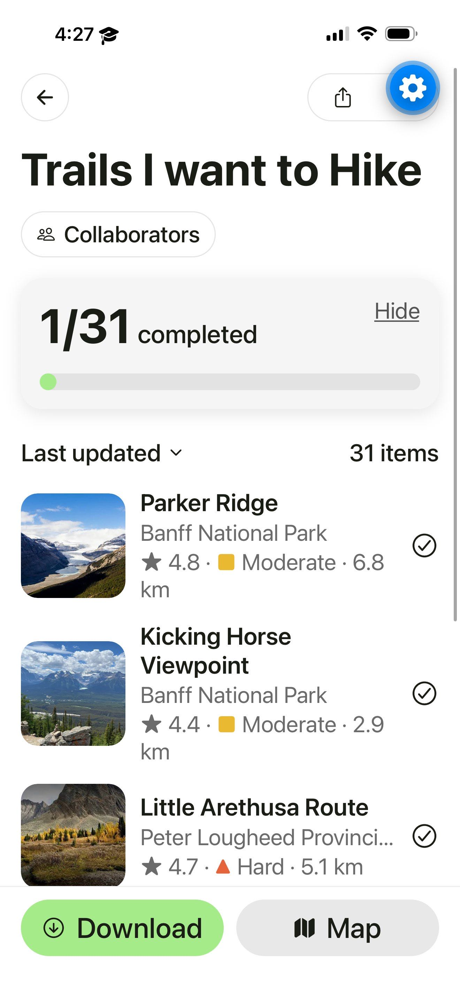
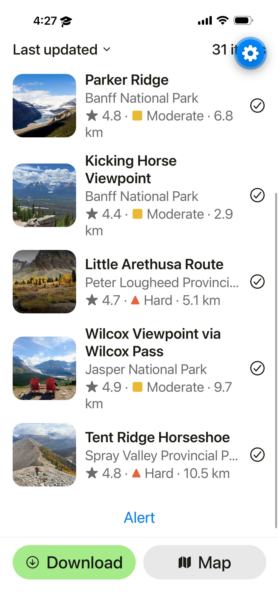
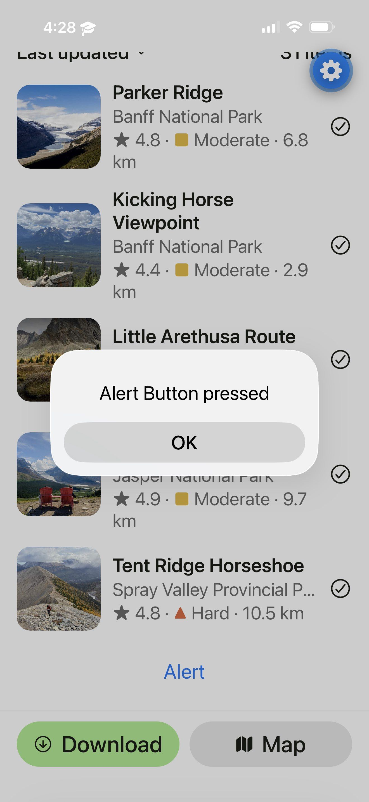

# AllTrails Saved List – Expo UI Clone

CPRG 303 Assignment: Building a Mobile UI with Expo and React Native

A copy of the AllTrails "Trails I want to Hike" saved-list screen, built with Expo, React Native and TypeScript. The Alert button at the bottom shows "Alert Button pressed".

## Original snapshot

## My app (iOS)

## Run it

npm install
npm start

## Credits

Trail photos are used for educational purposes only.
